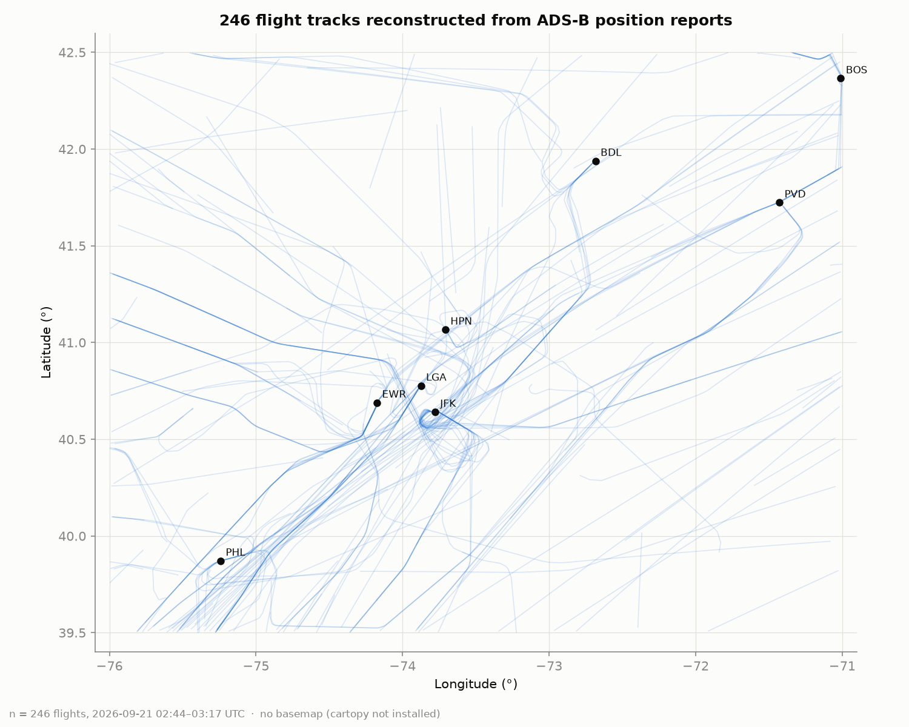
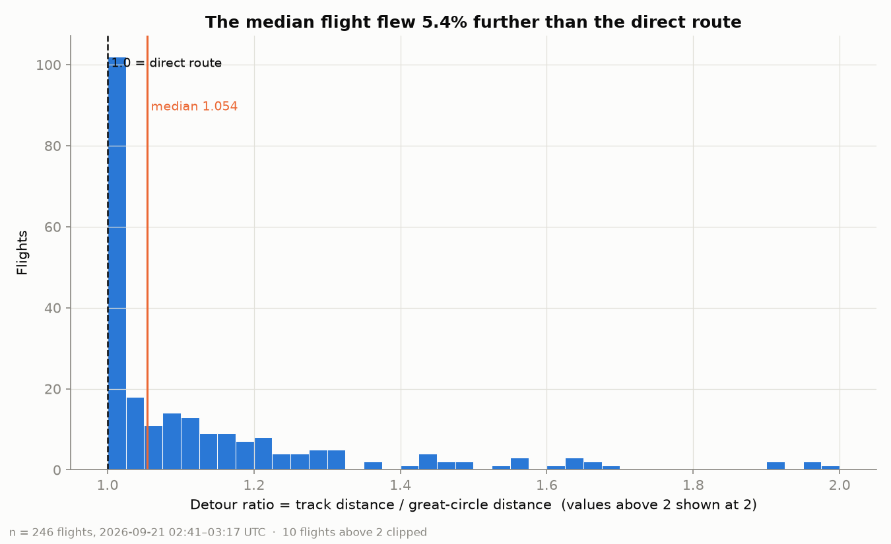

# Flight Data Analyzer

Collects live aircraft positions from the OpenSky ADS-B network, stitches them into flights, and measures how far real flights deviate from the straight-line route.



## The question

**Do aircraft in the busiest airspace in the United States fly systematically further than the direct route — and by how much?**

Aircraft do not fly straight lines. They follow airways, get vectored around traffic, hold for arrival slots, and avoid weather. I wanted to put a number on that. For every flight I saw, I compared the distance it actually flew (the sum of the hops between consecutive position reports) with the great-circle distance between where I first and last saw it. The ratio — the **detour ratio** — is 1.0 for a perfectly direct route.

**Answer (first sample run):** across 246 flights seen over New York, Philadelphia and Boston in a 30-minute window on the night of 2026-09-20, the **median flight flew 5.4% further than the straight line** between where I first and last saw it. But the distribution is lopsided: 39% of flights were within 2% of direct, while a quarter flew more than 20% further — and the big detours were almost all low-altitude aircraft being turned onto approach or departure paths, not cruise traffic. Details in [Results](#results).

## Setup

Four commands on a clean machine (Python 3.11 or newer):

```bash
python -m venv .venv
.venv\Scripts\activate          # macOS/Linux: source .venv/bin/activate
pip install -r requirements.txt
copy .env.example .env          # macOS/Linux: cp .env.example .env
```

Then paste your OpenSky `client_id` / `client_secret` into `.env` (free account: [opensky-network.org](https://opensky-network.org) → Account → API client). Without credentials the collector still works anonymously, but with a smaller daily budget and coarser 10-second time resolution.

Run it:

```bash
python -m flighttrack.collect --minutes 60      # poll the API for an hour, save raw data
python -m flighttrack.analyze                   # clean, group into flights, measure, chart, write report.html
python -m pytest                                # 43 tests, all math hand-checked
```

`collect` polls a bounding box over the US Northeast corridor (New York, Philadelphia, Boston) every 15 seconds by default. Change the box with `--bbox LAMIN LOMIN LAMAX LOMAX` or `OPENSKY_BBOX` in `.env`; keep it at or under 25 square degrees so each poll costs one API credit.

## How it works

Five stages, each writing its output to disk before the next one reads it, so an hour of collected data — which the API cannot give you back — is never at risk from a chart tweak.

1. **`collect`** polls `/states/all` on a timer and writes every row verbatim to a timestamped Parquet file, one per poll. It refreshes the OAuth2 token before it expires, sleeps for exactly as long as the API asks on a 429, and logs the remaining-credit header on every call. It never filters or converts anything.
2. **`clean`** drops fixes with no position, strips the whitespace OpenSky pads callsigns with, removes duplicate reports, and converts units once — every column is named with its unit (`geo_altitude_ft`, `velocity_kt`).
3. **`flights`** + **`metrics`** group fixes by transponder address (`icao24`, not callsign — callsigns are reused), split a group into separate flights wherever consecutive fixes are more than 30 minutes apart, and compute one row per flight: duration, track distance, great-circle distance, detour ratio, max altitude, mean speed. Nulls are dropped per metric, never per row.
4. **`viz`** reads those tables and writes six PNGs to `figures/`. It computes nothing new.
5. **`report`** writes `report.html` — the six figures with the numbers behind them, the ten longest detours, and what the data cannot tell you. Open it in a browser. It computes nothing new either, so every figure on the page traces back to a column an earlier stage wrote.

The one piece of real mathematics is the [haversine formula](flighttrack/geo.py), written by hand rather than imported: Pythagoras on latitude and longitude is wrong because a degree of longitude shrinks as you move away from the equator (it is half as long at 60° N as at 0°). The function is tested against known city pairs — Atlanta to Heathrow comes out at 6,760 km.

## Results

_Numbers below come from the committed sample: 122 anonymous polls, 15 seconds apart, 02:47–03:17 UTC on 2026-09-21 (about 11 pm Eastern), giving 15,082 unique position fixes from 323 aircraft. After grouping and dropping flights with fewer than 5 fixes or endpoints closer than 5 km, 246 flights remained. Rerun `python -m flighttrack.analyze` on your own collection to regenerate everything._



| Detour ratio | Share of flights |
|---|---|
| under 1.02 (essentially direct) | 39% |
| median | 1.054 |
| 75th percentile | 1.20 |
| 90th percentile | 1.55 |
| above 2.0 | 10 flights (4%) |

**What I noticed:** the 26 flights with a detour ratio above 1.5 had a median maximum altitude of 11,900 ft; the whole sample's median was 24,500 ft. The worst detours (ratios of 2–4) were regional jets at 3,000–15,000 ft, several with fixes on the ground — aircraft being vectored, holding, or taxiing after landing. Aircraft in cruise fly remarkably straight; the indirectness lives near the airports. That is a hypothesis from one half-hour, not a result, and the next step is an overnight collection to see whether it holds and whether it changes with time of day.

| Figure | Question it answers |
|---|---|
| `figures/flight_paths_map.png` | What does the traffic actually look like? |
| `figures/detour_ratio_hist.png` | How much further than straight do aircraft fly? |
| `figures/altitude_profiles.png` | How do aircraft climb and cruise? |
| `figures/distance_vs_duration.png` | Does time observed scale linearly with distance? |
| `figures/traffic_by_hour.png` | When is the sky busiest? |
| `figures/altitude_vs_speed.png` | Is there a cruise regime? |

## Limitations

Stating what this analysis cannot support matters more than what it can.

1. **I only see the part of a flight inside the box.** A Boston–Los Angeles flight appears here as a 20-minute westbound segment. "Track distance" and "duration" mean distance and time *observed*, not the whole flight, and the detour ratio is for that segment only. Flights that are mostly climb-out or approach — where aircraft turn the most — will look more indirect than a cruise segment would.
2. **Track distance is measured from sampled points.** Summing straight hops between fixes 10–15 seconds apart *underestimates* distance on turns (it cuts the corners) and *overestimates* it when an aircraft is nearly stationary and GPS jitter adds fake movement. Flights whose endpoints are within 5 km of each other are excluded for exactly this reason.
3. **Coverage is uneven and altitude comes in two flavours.** OpenSky is a volunteer receiver network: low-altitude aircraft far from a receiver drop out, so the data over-represents aircraft that are high and near cities. `geo_altitude` (GPS) and `baro_altitude` (pressure) can differ by hundreds of feet; the charts use geometric altitude and say so on the axis. Every altitude and speed field can also be null, and the drop rate is printed by `analyze` — check it before trusting a chart.

## Data

Data comes from the [OpenSky Network](https://opensky-network.org), a community-run ADS-B receiver network that makes its data available for research and non-commercial use. Please read their [terms of use](https://opensky-network.org/about/terms-of-use) before reusing anything here and cite them as they ask:

> Matthias Schäfer, Martin Strohmeier, Vincent Lenders, Ivan Martinovic, Matthias Wilhelm. *Bringing Up OpenSky: A Large-scale ADS-B Sensor Network for Research.* In Proceedings of the 13th IEEE/ACM International Symposium on Information Processing in Sensor Networks (IPSN), pages 83–94, April 2014.

Raw data (`data/raw/`) is not committed — it is large and regenerable only by collecting again. One processed sample (`data/processed/metrics.csv`) is committed so the figures can be reproduced without an API account.

## Repository layout

```
flighttrack/
  auth.py       TokenManager: OAuth2 fetch + refresh-before-expiry
  collect.py    polls /states/all, writes raw parquet     python -m flighttrack.collect
  clean.py      nulls, units, callsign trimming, dedupe
  flights.py    groups fixes into flights on time gaps
  geo.py        haversine, track distance, bearing (pure functions, no I/O)
  metrics.py    per-flight aggregates
  viz.py        the six charts
  report.py     report.html: figures + the numbers        python -m flighttrack.report
  analyze.py    clean -> flights -> metrics -> viz -> report
tests/          hand-checked math, synthetic gap-splitting, fake-API collector tests
data/           raw/ (gitignored) and processed/ (one sample committed)
figures/        committed — the README needs them
report.html     generated — open it in a browser to read the whole analysis
notebooks/      exploration.ipynb, scratch work only
```

## Blog post

_Link to the write-up goes here once it is published._

## License

MIT — see [LICENSE](LICENSE).
